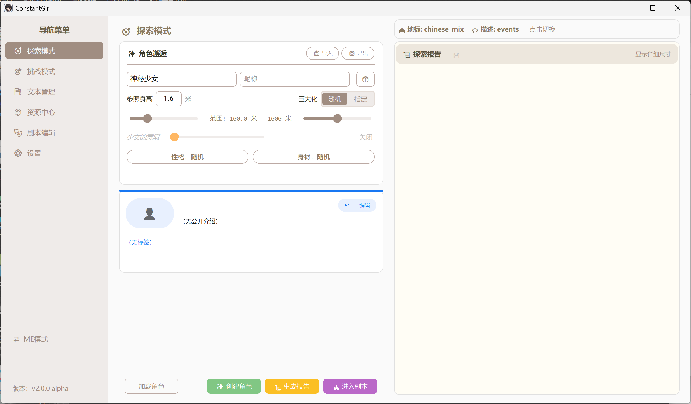

# ConstantGirl

<p>
  
  
  
</p>

一款纯本地运行的「巨大娘」主题互动创作工具：给少女设定身高与性格，把她同城市里的地标逐一对比，生成图文报告；再进入副本，让 AI 按剧本推进一段可以选择的文字冒险。角色、剧本、世界设定都能打包分享。



- **纯本地**：角色、地标、报告、设置都保存在本机，不需要账号，不上传数据
- **AI 可选**：不接 AI 也能建角色、出完整的测量报告；接上任意 OpenAI 兼容接口后才有副本剧情与角色聊天
- **两套界面**：1280×720 的桌面专业模式，与约 360×620 的低像素挂件模式，随时热切换
- **可分享**：角色、副本方案、世界包都能打成文件，别人一键载入即可游玩

> 当前处于 alpha 阶段：功能与界面文案仍在变动，升级前建议先备份 `data/`。

## 快速开始

### 方式一：下载发行版（推荐给玩家）

到 [Releases](https://github.com/j71408028-netizen/constant-girl/releases) 下载对应平台的压缩包，解压后直接运行，不需要安装 Python：

| 平台 | 解压后运行 |
|---|---|
| Windows 10/11 | `constant-girl.exe`（首次运行可能被 SmartScreen 拦截，选「更多信息 → 仍要运行」） |
| macOS 12+（Apple Silicon） | `ConstantGirl.app`；首次打开需右键 →「打开」 |
| Linux（X11 / XWayland） | `constant-girl` |

发行版的数据不在安装目录里，详见[数据与存档](#数据与存档)。

### 方式二：从源码运行

需要 Python **3.11 或更高**（3.10 装不上渲染后端 `imgui-bundle`；开发环境用 3.13）：

```bash
git clone https://github.com/j71408028-netizen/constant-girl.git
cd constant-girl
python -m venv .venv
```

<details>
<summary>Windows（PowerShell）</summary>

```powershell
.\.venv\Scripts\Activate.ps1
python -m pip install --upgrade pip
python -m pip install -r requirements.txt
python main.py
```

</details>

<details>
<summary>macOS</summary>

```bash
source .venv/bin/activate
python -m pip install --upgrade pip
python -m pip install -r requirements.txt
python main.py
```

需要可用的 Tcl/Tk（python.org 安装包或 Homebrew Python 均可）。渲染后端目前只提供 Apple Silicon 轮子。
</details>

<details>
<summary>Linux（X11 / XWayland）</summary>

```bash
sudo apt install python3-tk fontconfig fonts-noto-cjk   # Tk、字体查询、中文字体
source .venv/bin/activate
python -m pip install --upgrade pip
python -m pip install -r requirements.txt
python main.py
```

纯 Wayland 合成器下副本窗口无法创建，请在 X11 或 XWayland 会话中运行。
</details>

### 两种版本的差别

功能完全一致，只是数据的存放位置不同：

| | 发行版 | 源码版 |
|---|---|---|
| 数据目录 | 系统用户目录（详见[数据与存档](#数据与存档)） | 仓库内的 `data/` |
| 内置资源 | 首次启动时复制到数据目录 | 直接使用仓库里的 `data/packs`、`data/static` |
| 附带内容 | 仅运行所需文件 | 另有自检、打包脚本与开发者工具 |

### 第一次打开

1. **（可选）配置 AI**：进入「设置 → 生成 → 网络与 AI」，填接口地址、模型名与 API Key。内置智谱 AI、DeepSeek、ChatGPT 三个模板，也可以新建任意中转站或本地服务，填完可点「测试连接」。跳过这一步不影响建角色与出报告。
2. **建角色**：在「探索模式」里设定姓名、身高、性格与身材，或从已有档案继续。
3. **生成报告**：程序抽取地标，把身高、步长、腿长等部位与之一一对比，生成尺寸表与描述文本。测量与报告完全在本地完成。

想直接进剧情，就在「剧本编辑」里挑一个副本方案，点「进入副本」。

### ME模式

- 不同于主界面的挂件窗口，点导航栏底部的「⇄ ME 模式」即可切换。
- 简明而独特的使用体验：低像素UI、沉浸式调查，同时不影响报告和副本等功能。（相关视觉效果正在完善中）

## 功能一览

| 模块 | 说明 |
|---|---|
| 探索模式 | 测量角色身体部位与地标的对比，生成探索报告；创建角色后可长期存档、查看新闻与聊天 |
| 挑战模式 | 把角色与资源打包成加密挑战包（`.chal`），他人在你设定的条件下挑战副本结局 |
| 文本管理 | 管理地标与描述（quip）等文本资源，支持多风格与自定义风格 |
| 资源中心 | 世界包、风格组、副本方案、取材表、挑战包的总览与一键切换，选择即时生效 |
| 剧本编辑 | 编写副本方案： AI 提示词、章节、触发器、结局、演化属性 |
| 设置 | 主题外观、字体、生成参数、网络代理与 AI 配置 |

## 概念速查

- **地标**：可对比的建筑、桥梁、山川，带尺寸与方向（纵向 / 横向），按风格分组。
- **描述**：按观测等级、介入度、破坏性匹配的文本片段，是报告正文的素材来源。
- **观测等级**：按身高分 5 档（`Small` → `Colossal`），决定可用描述与展示格式。
- **耦合等级**：你以什么身份进入副本——`Velum` 只读、`Solea` 任务执行者、`Bulla` 个体互动。
- **性格**：巨大化角色内在的底色、沉浸程度和行为习惯，不同性格的角色会有着截然不同的外在表现。
- **介入度 / 破坏性**：角色此刻与外界互动的表现，各分 1~4 级。
- **行动点数**：角色的活力（0~100），随时间缓慢恢复；会被生成报告、进入副本等所消耗。
- **副本**：角色在特定时空下行动的可视化剧情，可回放或再次经历。

更详细的定义、易混词对照和内部命名见[界面术语表](docs/terminology.md)。

## 数据与存档

```
data/
├── archives/   角色档案与历史报告，按角色名归档
├── packs/      内置资源包：地标 landmarks/、描述 quips/、副本方案 scenarios/、挑战包 challenges/、小游戏 minigames/
├── static/     取材表 materials/<组名>/（names、presets、personalities、news 四张 csv）与行为包 behaviors/
├── user/       设置、API Key、挑战秘钥、报告与回放、截图、地址注册表
└── worlds/     世界包
```

发行版的数据目录在系统用户目录：

- Windows：`%LOCALAPPDATA%\constant-girl\data`
- macOS：`~/Library/Application Support/constant-girl/data`
- Linux：`$XDG_DATA_HOME/constant-girl/data`（默认 `~/.local/share/constant-girl/data`）

**备份就是把整个 `data/` 目录拷走**（升级、换机、试世界包前都建议先拷一份）。项目旧称「巨大娘生成器 / GiantessGenerator」，旧版数据目录会在首次启动时整体迁移到新名下，内容不改写。

## 制作与分享

程序内资源具有丰富的叙事形式和高度开放性，以下是制作或编辑的入口：

| 想做的东西 | 说明 | 入口 |
|---|---|---|
| 地标、描述、副本方案 | 可供探索的资源 | 「文本管理」「剧本编辑」 |
| 取材表 | 一个目录四张 csv（姓名、身材、性格、新闻），缺的成员自动回落到内置 default 组 | 用 Excel 编辑 `data/static/materials/` |
| 世界包 | 把资源包与取材表打成 `<world_id>.world.zip`，激活期间接管各数据源，停用即恢复 | 「资源中心」 |
| 行为包 | 世界包可选携带的 Python 代码包，激活期间覆盖核心算法 | [行为包开发指南](docs/designs/behaviors/dev-guide.md) |
| 副本小游戏 | `mini_game` 触发器的运行时与作者 API | [小游戏框架](docs/designs/dungeon/minigame.md) |
| 挑战包 | 角色与资源打成秘钥保护的 `.chal`，玩家在挑战模式里达成结局 | 「挑战模式」 |
| 世界地址 | 为你的世界申领注册表地址，供地标 / 描述风格跨世界引用 | [地址系统作者指南](docs/designs/address-system/authoring.md) |

## 平台支持

| 平台 | 状态 | 说明 |
|---|---|---|
| Windows 10/11 | ✅ 支持 | 发行包；小游戏依赖 WebView2 运行时 |
| macOS 12+（Apple Silicon） | ✅ 支持 | 发行包；渲染后端暂无 Intel 轮子 |
| Linux · X11 | ✅ 支持 | 发行包（onedir + tar.gz）；需 `python3-tk` 与中文字体 |
| Linux · Wayland + XWayland | ⚠️ 可用 | 副本窗口经 XWayland 显示，窗口置顶依赖窗口管理器的 EWMH 支持 |
| Linux · 纯 Wayland | ❌ 不支持 | 副本窗口（GLFW）无法创建 |

平台细节与已知限制见 [Linux 支持说明](docs/users/platforms/linux.md)。

## 欢迎加入

项目还在快速迭代阶段，欢迎任何形式的参与——写一套地标 / 描述风格、做一个副本方案、报一个 bug，都算。

- 改代码前先读 [AGENTS.md](AGENTS.md) 与[架构说明](docs/dev/architecture.md)，分层与命名由离线守卫强制
- 提交前跑 `python tests/run_checks.py`（离线，不需要显示器）；改动涉及窗口的再追加 `--smoke`
- 提交信息用约定式提交：`<type>(<scope>): <subject>`，正文用中文

想读更多：[文档总入口](docs/README.md) 按读者分流；演化公式见[角色演化模型](docs/designs/character_evolution.md)；发版流程见[发布与打包](docs/ops/release.md)。

## 许可证与声明

软件以 [MIT 许可证](LICENSE) 发布（Copyright © 2026 XiaoCui）。代码与部分素材由 AI 辅助生成。

本工具是创作辅助软件，生成内容的使用与发布由使用者自行负责；请勿用于违反当地法律或平台规则的用途。
