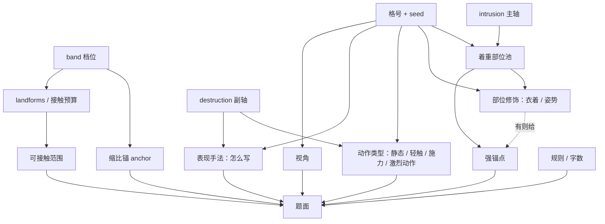

# quip_profiles/ — 一个题材的全部数据

`quip_draft_bench.py` 的引擎不认识任何具体题材。两根轴各 4 级是什么语义、每级轮换哪些着
重部位、动作只分哪几档、衣着与姿势挂在哪里、表现手法分哪几种、哪些地貌词归哪一档、
视角池有哪些——全部在这里。换题材 = 换一份 JSON，代码不动。

题面按 **DeepSeek** 调过，也只在 DeepSeek 上验过；这份样板与它同口径。换后端（或换模型
系列）之后，卡的措辞、视角的一句说明、收束句禁令、输出 JSON 的形状都要重新看一遍：
不同模型对「列表」和「否定句式」的反应差别很大。另外这套题面**尚未完全稳定**，一到两成
条目仍要人手改——所以一次别跑满整档，先跑一格看。

唯一不由 profile 定的是**档位的名字与区间**：`small` / `medium` / `large` / `huge` /
`colossal` 这五个 key 与它们的区间是主程序 `core/logic/sizing.py` 的常量
（`SIZE_CATEGORIES` / `SIZE_DISPLAY`），运行期按身高 `get_size_category()` 只会落到这五个
key 上。profile 只能给每档写「大概能碰什么」（`can`）、缩比锚（`anchor`）与边界（`limits`）；
改名或多写档位，产出的语料主程序取不到，`doctor` 会报。

覆盖范围则是自由的，而且是**该省的**：一个题材通常只关心自己写的那几段尺寸——写十米级的
城郊拆迁，就不必顺带交代万米级的行星工程。`bands` 里没写的档位只是没有语料，`doctor`
只把它当提示打出来，不报错；`landforms` 里留着那些档位的词也不用清，出题时用不到而已。
样板之所以写满五档，是因为它要被复制成各种题材，留个全貌。

| 文件 | 是什么 | 入库 |
|---|---|---|
| `template.json` | 通用起点：从 `giantess.json` 复制而来（近现实巨女，5 档全覆盖）。复制它改内容即可，不必从空文件写 | ✅ 入库，这目录里唯一该进版本库的一份 |
| 其他 `<题材>.json` | 各人自己写的题材数据（例如本机的 `giantess.json`：近现实巨女，从 `.workbuddy/quip_master.md` 与 `quips_scale_whitelist.md` 导出） | ❌ 不入库，见下 |

```bash
python developer_tools/quip_draft_bench.py --profile template plan --cell small:2:3 --count 1
python developer_tools/quip_draft_bench.py --profile ./my_world.json doctor
```

`--profile` 接受名字（取本目录 `<名字>.json`）或直接给路径。

## 入库范围

一个题材就是一位作者对“多大、多狠、写什么”的全部口径，属于写作者的私有数据，**不入库**：
根 `.gitignore` 忽略 `quip_profiles/*.json`，只放行 `template.json`。所以克隆后这里只有样板，
`--profile giantess` 会报「找不到 profile」并列出已有文件；要写自己的题材，复制样板改内容。

仓库里只留样板：口径的长期约定都在这份 README，具体题材内容只在各人的 JSON 里。
`--profile` 的默认值仍是 `giantess`（作者本机那份）；本机没有这份文件时显式 `--profile <名字>`。

## 术语

| 词 | 指什么 |
|---|---|
| 观测等级（band，短称「档位」） | 主体的尺寸档，也是 `size_category` 的取值；JSON 里 `bands` 的顺序即高低，第一位最低。key 与区间由主程序定（见开头），profile 只填内容 |
| 主轴（intrusion）/ 副轴（destruction） | 两根隐坐标轴。主轴挑着重部位；副轴同时挑动作类型与表现手法 |
| 隐坐标 | 主轴与副轴的那两个数字；只决定轮换哪张场景卡，不出现在题面里 |
| 格（cell） | 观测等级 × 主轴 × 副轴 的一个组合；每级 14 格（(1,4)、(4,1) 不存在），5 级共 70 格 |
| 场景卡（card） | 一格里按坐标轮换出来的一条提示：着重部位 · 动作类型 · 表现手法 · 视角 |
| 题面（brief） | 给写手的一条待写提示，由观测等级、场景卡、可接触范围与规则组成 |
| 表现手法（reach） | 这一条「怎么写」：对比／比喻／特写／转述或错认／数字错位／静止／省略／单一感官。只管写法，不管停在哪一步 |
| 动作类型（action） | 这一条「用多少力」：静态 / 轻触 / 施力 / 激烈动作，严格对应副轴 1~4；某一档可按介入度换名（如 (4,4) 的「占有」） |
| 视角（angle） | 这一条由谁来看：一串平铺的开口，按权重抽，不带候选词表 |
| 占位符 | `{name}` / `{nick}`：正文里的角色名与昵称，运行时替换；别写别的花括号 |
| 写手 | 人、AI 或 agent；三条路走同一套校验与落盘 |
| 落盘 / 收卷 | 落盘 = 写进语料 CSV；收卷 = `check` / `append` 那一轮校验 |

## 不存在的两格

两根轴各有 4 级，但 **(1,4) 与 (4,1) 写不出来**：端点在这里互相否定——1 级介入是「只作为
存在出现、没做任何事」，写不出 4 级破坏的「以摧毁为唯一目的」；4 级介入是「身体占据、
拿建筑当玩物」，也写不出 1 级破坏的「小心对待」。所以每级 14 格，`grid` 里也不写这两格，
`--cell 1:4` / `--cell 4:1` 直接报错（`apply --set` 同样拦）。

## 一次撰写只做一个观测等级

`plan` / `write` / `draft` / `fill` / `prompt` 都只处理**一个**观测等级：目标跨等级时直接
报错退出，提示用 `--band` 挑一个。理由是等级内部自洽，而一套描述风格自身的表达边界也按
等级分——把 small 的写法带到 huge 上，事后按坐标调得回来，按等级却调不回来。

`status` / `check` / `append` / `apply` 不受这条限制：它们只记账、只改坐标，不产出正文。

一个等级 14 格，每格 3 条正好 42 条，落在「一个等级约 20~100 条」这个量里，也是一次能
把握住的规模。真要写更多，分批做，不要靠一次调用堆；一批超过约 100 条会在 stderr 提示。

写哪几格也不由工具往下砍：先 `status` 看表，哪格少就 `--cell 档位:主轴:副轴` 补那几格。


## 元素依赖



实线是直接决定，虚线是可选的部位修饰。**只有 `H`（着重部位，连同它给出的衣着/姿势）
是强锚点**；动作类型只定强度，表现手法只定写法，视角只定由谁看，可接触范围只限定
“写到接触时允许碰多大的东西”。它们都不替写手把具体动作和句子写完。

注意 `M` 与 `R` 都挂在同一条副轴上，但两者互不映射：副轴 2「轻触」不规定必须用哪个
手法，副轴 3「施力」也不要求写成特写。手法跨级复用是有意的——它不承担破坏程度。

## 一张卡有什么

写手看到的是：

1. **着重部位** —— 跟主轴（`intrusion`）走。部位就是这一条要重点描写的身体/载体部分；
   衣着不单独出现，只在对应部位出现时写成“腿（穿着长筒袜）”这种形式。
2. **动作类型** —— 跟副轴（`destruction`）走，四档严格对应 1~4：静态（不施力，碰到的
   东西不留形变）、轻触（力只到碰着的那一点）、施力（接触的一片成片损坏，边界清晰）、
   激烈动作（接触面下的东西先于她垮）。坐下/躺下/蹲下这类算姿势，不算动作类型。
3. **表现手法** —— 同样跟副轴走，但只定「怎么写」，不定「写到哪一步」。给的是手法名加
   一句说明（“对比：把两端并在一处……”），不写成整句，也不许当结果交代。
4. **视角** —— 观察者，平铺的一串开口，每个带一句「怎么入」与抽样权重。只影响由谁来看，
   不判档；**不带候选词表**——词表进题面，写手就会当成必写清单。
5. **可接触范围** —— 按接触方式分组，限定这一条写到接触时能碰多大的对象。

题面里还带一节「术语」，就地解释两个容易被当成暗号的词：**缩比**是这一档多大
（手法与动作按它折算成合适的东西，正文不写尺寸）。另有一条称呼写法：可以直接写称呼，
也可以写 `{name}`（角色名）/ `{nick}`（昵称），运行时替换成当前角色；花括号只认这两个。

**档位不描述“适合写什么”，只给一个缩比锚**（`bands[].anchor`）。档位文案（`can`）只用来
让写手知道这一档大概能碰到什么，不抄分级散文。

**表现手法只给手法，不给落点**（`craft.reach`）。一张平铺表 8 条，每条是 `[手法, 说明]`，
说明一句话点出怎么写，不带实体、不带数量。各破坏性档共用同一批：手法跨级复用是设计——它
不承担破坏程度，破坏程度由动作类型承担，所以不必把同一套抄四遍。写成整句或写成结果
（“接触面所及什么都不剩”）等于替写手把这一条写完，越写越窄；`doctor` 对带句内位置词
（最后、开头、随后、只剩……）的说明会报。

**为什么不再有“通道”**：通道（看得见的／记录上的／身体与环境）曾经承担“副轴从哪儿看出来”，
实际效果是把整格压成同一种骨架，与视角一一绑定。现在副轴的两件事拆开：动作类型决定
破坏落到多大范围，表现手法决定用什么笔法写它。缩比仍由写手按 `anchor` 自己完成。

## 可接触范围：按碰法分条，不合并

`touch` 是一张表，一项一种接触方式，各带自己的对象范围与边界：

| key | 标签 | `objects` | 判据（`can` / `cannot`） |
|---|---|---|---|
| `reach` | 踩上、跨过、靠上去 | `contact` | 只要够得着，对象 ≤ 本档 |
| `cover` | 坐下、躺下、压、包裹 | 空 | 得盖得住，盖不住的只能压到一角 |
| `poke` | 指尖点、推、拨 | `upper` | 只碰一个点，对象可高一档，但只动得了那一处 |
| `hold` | 握住、捏住、夹住、含住 | 空 | 圈得住才拿得起来，拿起来就能整件处置 |

`objects` 决定题面里挂哪张词表：`contact` 挂本档的，`upper` 挂高一档的，
空则不给词表、只给判据（这种接触的对象由接触部位本身定）。

**这是“描写里允许主体碰到什么”，不是动作清单，也不是要求这一条必须接触。**
一条静态的题面可以完全不碰东西；写到了接触，才按对应的接触方式取范围。

**握与拨不能合成一句。** 握要求掌口圈得住，对象必须比接触部位小，抓住之后才能整件处置；
指尖只碰一个点，对象可以大得多，但只动得了碰的那一处。写成“握/捏/指尖拨弄（对象可高一档）”
时，前半句与后半句对不上——能指尖拨到的东西，根本握不住。

## 衣着与姿势：挂在部位上，不是独立变量

姿势和衣着是描述本身的物理条件：她站起来时手就不该撑地；衣服裹得严时就不该有大片肌肤接触。
它们不占独立的变量槽，也不用 `a:` / `b:` 类型编号管理。做法是把修饰写在部位自己那一项里：

```json
"parts": {
  "腿": {
    "level": 2,
    "wear": ["短裙", "长裙", "长筒袜"],
    "posture": {
      "站立": "手上不支地，脚底是唯一接触面",
      "交叠": "两条腿叠在一起，接触面只有腿侧"
    },
    "wear_every": 3,
    "posture_every": 2
  },
  "膝盖": 2,
  "指尖": 4
}
```

- **一个部位一个键**：`level` 是它属于哪一级，与衣着/姿势写在同一个对象里。改部位名只改
  这一处，不必再去别处同步；没有修饰的部位直接写等级（`"膝盖": 2`），也可以写成
  `[2, "短裙"]`（首项等级，其余是衣着）。
- 只有轮换到 `腿` 这个部位时，才可能带出“腿（穿着长筒袜）”或“姿势：站立”。
  长筒袜不会在写“脚”“膝盖”时凭空出现；礼服、长风衣只挂在“整片身形/整个身体”上。
- `wear` 可以是列表，也可以是对象（取键名）；`posture` 可以是列表，也可以是
  `{"姿势": "物理约束"}`。`wear_every` / `posture_every` 控制每几条带出一次，默认 3 / 2。
- 旧的写法（`"parts": {"1": [...]}` 配并列的 `part_details`）仍能读，但部位名要在两处各写
  一次；两种写法同时出现时按单表算，混用会报错。
- **题面里不出现任何类型标记。** 没有“姿势（b:2）”“衣着（a:1）”这种行；`plan` 输出、
  `prompt` 的 user 段、`write`/`draft` 的题面都只写“着重部位：腿（穿着长筒袜）”。
- 旧语料里的 `a/b` 标记仍能识别（算字数时剥掉、槽内文字不参与越档判定），但不再单独统计。

## 怎么换一个题材

1. 复制 `template.json` 成 `<题材>.json`（例如 `my_world.json`；本目录的 JSON 默认不入库）。
2. 改 `title` / `subject` / `band_label`：它们是题面和提示词里出现给写手看的词。
3. 改 `bands` 的内容：每档一句 `can`（这一档大概能碰什么）、一句 `anchor`（这一档的缩比锚，
   “这么大是多大”）。写手拿它把判据落成这一档的尺寸，务必写成能换算的量（“沿街三五栋”
   “一个街区”“一座县城”）。`limits`（可选）写这一档写不进什么，只给读 profile 的人看，
   不进题面。**`key`、`display` 与顺序都不要动**：它们是主程序的契约（见开头），
   `doctor` 会把多写、改了区间的档位报出来。用不上的档位直接整档删掉——缺档位是允许的，
   也不会报错；只留一档同样能出题。
4. 改两根轴：`axes.intrusion` 与 `axes.destruction` 的 `levels`（1~4 各一句）、
   `not_yet`（本级“还没到”的下一级，用来卡边界）。这两根轴对写手是隐的，只用来轮换场景卡。
5. 改 `craft.parts`：**一张表，一个部位一个键**，等级与衣着/姿势都写在它的值里
   （写法见上一节）。每级至少 3 个着重部位；主轴只决定抽哪一级。同一个部位词只能出现在
   一级——跨级重复会让 `apply --by` 判不出坐标，解析期就报错。
6. 改 `craft.action_modes`：**四档严格对应副轴 1~4**，`{"1": "静态", "2": "轻触",
   "3": "施力", "4": "激烈动作"}`。题面里那句「用多少力」的说明在代码的 `ACTION_HINTS`，
   按动作名取，所以这四个默认名不要自造（换了名字只会落回默认提示）。介入度不参与挑动作，
   但可以给某一档挂**介入度变体**——写成对象，`default` 是默认名，数字键是介入度：

   ```json
   "4": {"default": "激烈动作", "4": "占有"}
   ```

   运行时按坐标取：(4,4) 用「占有」，其余破坏性 4 的格仍用「激烈动作」。变体名要在
   `ACTION_HINTS` 里登记一句说明，否则题面只落到泛化的默认句。
7. 改 `craft.reach`：8 条，每条 `[手法, 说明]`。**一张表就够**——手法是「怎么写」，
   各破坏性档本来就用同一套，不必四级抄四遍。真要某一档换笔法才写成按级分组
   `{"1": [[…]], …}`，`doctor` 只查同级不重名、说明非空、说明不带位置词。
   手法说明里不要出现「最后 / 结尾 / 之后」这类句内位置词，`doctor` 会报。
8. 改 `touch`：按这个题材里的接触方式重写，一种一行，`objects` 指明挂哪张词表。
   把“能碰什么”合并成一条也行，但握得住与够得着对应的对象范围不同，合并就必然自相矛盾。
9. 改 `landforms`：**按档位分组**，键是档位名，值是词表，一组一行：

   ```json
   "landforms": {
     "small": ["路灯", "站牌", "广告牌", "居民楼"],
     "medium": ["居民楼", "大楼", "写字楼"],
     "large": ["摩天大楼", "大桥"]
   }
   ```

   「居民楼」既是 small 也是 medium，就在两组里各写一次。这是**判定依据**——一条描述里
   接触到的词，只有全在本档词表里才算不越档；同一档位里写两遍会报错。
10. 改 `angles`（视角池）：`[{label, weight, note}]`。`note` 是一句「怎么入」，必须写；
    `weight` 决定抽中的概率，三档即可（人已在场 3 / 物件与场所 2 / 制度与数据 1）。
    **不要写 `cues` 或候选词表**——列进去的词会被写手当成必写清单，整批文体跟着塌成一种。
    `doctor` 对带 `cues`、缺 `note`、权重全为 1 的视角池会报。
11. 跑 `doctor`（`--craft` 打印场景卡全表、动作类型与部位修饰），把报出来的缺项补完；
    再 `plan --cell <档>:2:2` 看题面读着顺不顺。

## 字段

### 必填

| 字段 | 形态 | 说明 |
|---|---|---|
| `bands` | `[{key, display, anchor, can}]` | 可只写用得到的档（缺档不报错），`key` 与 `display` 必须与 `core/logic/sizing.py` 一致，顺序即高低、第一位最低；`limits` 可选，只给人看 |
| `axes.intrusion` / `axes.destruction` | 见下 | 两根轴，键名固定（CSV 列名是契约） |
| `patterns` | 四个正则字符串 | `contact` 接触动词、`loc_only` 方位词、`neg` 否定词、`observe` 观测/通报词 |
| `landforms` | `{档位: [词, …]}` | 判定依据，顺序即题面里的展示顺序（按档位分组；旧的 `[[词, [档位…]], …]` 仍可读） |
| `craft` | 见下 | 场景卡素材：着重部位 / 动作类型 / 部位修饰 / 表现手法 |
| `angles` | `[{label, weight, note}]` | 视角池；平铺的开口，`note` 必写，不带词表 |

轴的形态：

```json
"intrusion": {
  "label": "介入度",
  "levels": {"1": "…", "2": "…", "3": "…", "4": "…"},
  "not_yet": {"1": "做出普通日常动作", "2": "动作明确指向人造物"}
}
```

`not_yet` 只在 1~3 级有意义：第 1 级的“尚未到 X”就是第 2 级的内容。

场景卡的形态：

```json
"craft": {
  "part_label": "着重部位",
  "reach_label": "表现手法",
  "parts": {
    "腿": {"level": 2, "wear": ["短裙", "长筒袜"],
           "posture": {"站立": "脚底是唯一接触面"}},
    "膝盖": 2,
    "手": 3,
    "指尖": 4
  },
  "action_modes": {
    "1": "静态", "2": "轻触", "3": "施力",
    "4": {"default": "激烈动作", "4": "占有"}
  },
  "reach": [
    ["对比", "她的感受与旁人的判断互相错开，两边都要有"],
    ["比喻", "一个喻体，只挂在她身上"]
  ]
}
```

`parts` 是一张表：键是部位名，值是 `level`（以及可选的衣着/姿势）。同一个部位只写一次，
改词只改这一处；等级写成数字即可，比如 `"膝盖": 2`，也可以写成 `[2, "短裙"]`。
`doctor --craft` 会按等级把这张表重新分组打印，方便核对。

`action_modes` 的每一档既可以只写一个名字，也可以写成对象：`default` 是这一档的默认名，
数字键是按介入度覆盖的变体。上面的写法让 (4,4) 出「占有」，其余破坏性 4 的格仍是
「激烈动作」。变体名同样要在代码的 `ACTION_HINTS` 里有登记，否则题面只会给出泛化说明。

`reach` 一张平铺表，各破坏性档共用同一批手法（要给某一档另写一套时才改成按级分组
`{"1": […], …}`）。至少 3 条，样板给 8 条，一条一个 `[手法, 说明]`：手法是“怎么写”，不是这一句
的成稿，所以说明里不许出现具体实体、数量或绝对尺度，也不许规定写在句中哪一头。
同组三条靠“格序号 + 序号”轮换，跨级复用同一套手法是正常的。

### 可选（不写有默认值）

| 字段 | 默认 | 说明 |
|---|---|---|
| `name` | 文件名 | 报告与 CSV 名里显示 |
| `title` / `subject` | name / “主体” | 题材名与主体，进提示词 |
| `band_label` | “尺度” | “体型”“体量”“规模”随你 |
| `craft.action_modes` | 1 静态 / 2 轻触 / 3 施力 / 4 激烈动作 | 动作强度，严格对应副轴 1~4；某一档可写成 `{default, 介入度: 变体名}`，出题时按主轴覆盖；改默认名只会落回默认提示 |
| `craft.parts[*].wear` / `.posture` | 空 | 部位修饰：衣着与姿势写在部位自己那一项里，只有该部位出现时才偶尔带出 |
| `craft.part_details` | 空 | 旧写法：并列的部位修饰表，键必须在 `parts` 里。新 profile 直接写进 `craft.parts` |
| `craft.genres` / `craft.consequences` | 空 | 旧写法：按级另给的短名与说明表。手法已收成一张 `craft.reach`，新 profile 不必写 |
| `touch` | 空 | 接触方式表：`[{key, label, objects, can, cannot}]`，见上。空则题面只给“够得着”一张词表 |
| `grid` | 空 | `{"1-1": "释义"}`，14 格；(1,4)、(4,1) 不写；缺格时退化成“主轴 3 × 副轴 2” |
| `vague` | `[]` | 模糊词：只能当背景，不得在接触句里承担尺度（提示，不判错） |
| `banned` | `[]` | 禁用词：出现即错 |
| `text` | `{12, 34, 8}` | `min` / `max` 正文长度（不含标记），`summary_max` 标签上限，`sentences` 句数区间（默认 1~3） |
| `rules` | `[]` | 题材相关的写作约束，逐条进题面 |
| `notes` | `{}` | 只在 `doctor` 里打印的自述 |
| `patterns.qualifier` / `clause` | `^\s*的` / 按中文标点切句 | 一般不用改 |

CSV 七列与 4×4 权重不写在 profile 里：它们是代码里的常量（`COLUMNS` / `DEFAULT_STEP`，
后者与 `QuipRepo.default_step` 同源），不再接受覆盖，`doctor` 会直接与主程序比对。
同理，接触方式的几何约束只写 `touch` 一处，不要再另开一份同义的口径说明——两份必然对不上。

## 判定是怎么发生的

只有三条判据，都靠 profile 提供数据：

1. **越档**：句子里出现的接触对象词，其 `landforms` 档位列表不含本条所在档 → 越档。
   “接触对象”要同时满足：同一分句里有 `patterns.contact` 的动词、不在 `patterns.loc_only`
   的方位短语里、不在 `patterns.neg` 的否定里。`qualifier` 用来放过“路灯的样子”这类定语。
   标记 `[c:1:…]` 内部的文字不算——那是替换槽，属于同格别的条目。
2. **模糊词**：同上命中，但词在 `vague` 里 → 只提示，不判错。
3. **禁用词**：正文里直接出现 `banned` 中的词 → 判错。

结构上还查：字数按**去掉标记后**的正文算；`[a-e]:编号:文本` 是旧语料合法标记
（`MARK` 也算），字母超出 a~e、缺编号、括号不配对才算错；`{name}` / `{nick}` 是运行时占位符，
放过，其它花括号判错。新题面不生成类型标记，这些规则只用于已有语料。

坐标（两根轴）**不从文本回推**：线索词假阳性太高，见 `.workbuddy/quip_master.md` §7.4 的实测。
级别由出题时的隐坐标决定，工具按它轮换场景卡；写完若觉得某条气质不对，人用
`apply --by 行=部位词:手法词` 覆盖校正（`--set 行=i:d` 是数字写法）。
工具只判“尺度对不对得上”，不判坐标。

`--by` 后半段的手法反查只在**该手法名全表只属于一级**时有效；样板四级共用同一套手法名，
所以这半段大概率会报「在 1、2、3、4 级都出现」，此时用 `--set 行=i:d` 指定副轴。

## 和 `.workbuddy/` 的关系

本机那份 `giantess.json`（不入库）是从 `.workbuddy/quip_master.md`（格释义、视角池）与
`quips_scale_whitelist.md`（地貌词表、模糊词、禁用词、接触方式）导出的。

那两份 Markdown 是**给人读的口径说明**，引擎不解析它们。改词表时两边都要改：
Markdown 给下一个人看，JSON 给脚本判。`doctor` 只能查 JSON 自洽，查不出两边不同步。

引擎和本目录的文档都不引用任何现成 CSV：产物只写 `_out/quip_draft/<profile>.csv`，
要读写别处的语料就显式 `--csv <路径>`。开发期的实验语料另存在 `.workbuddy/`，
不是成品，也不是基准——工具侧不认它。
